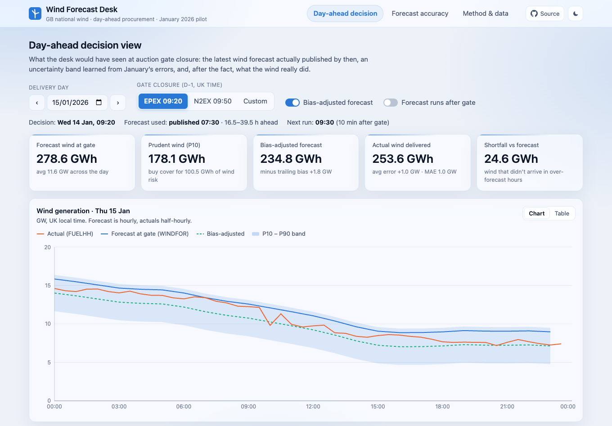
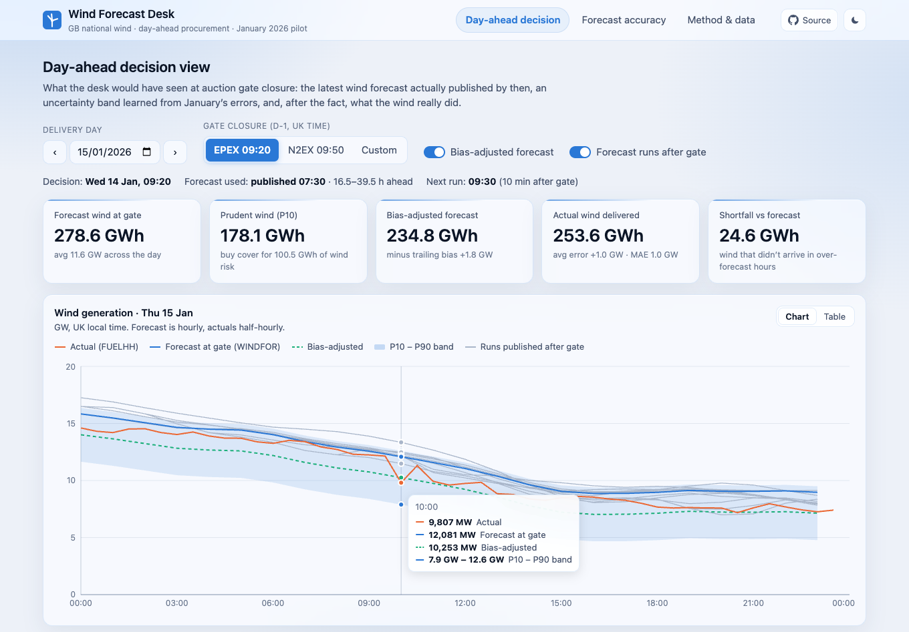
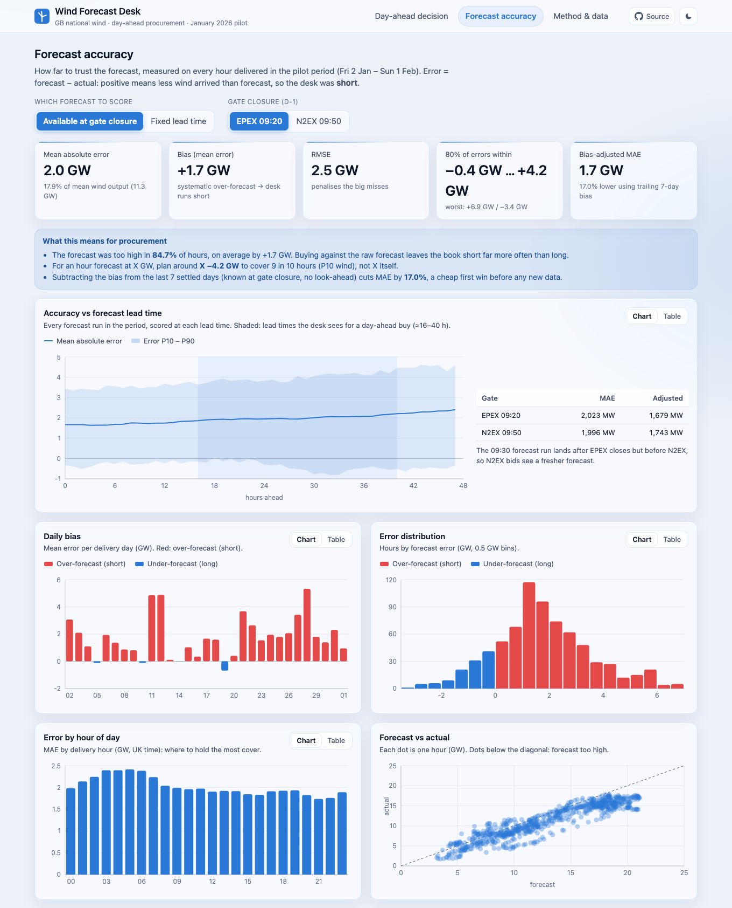
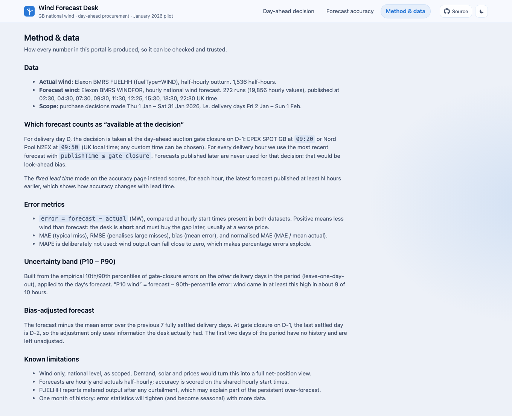
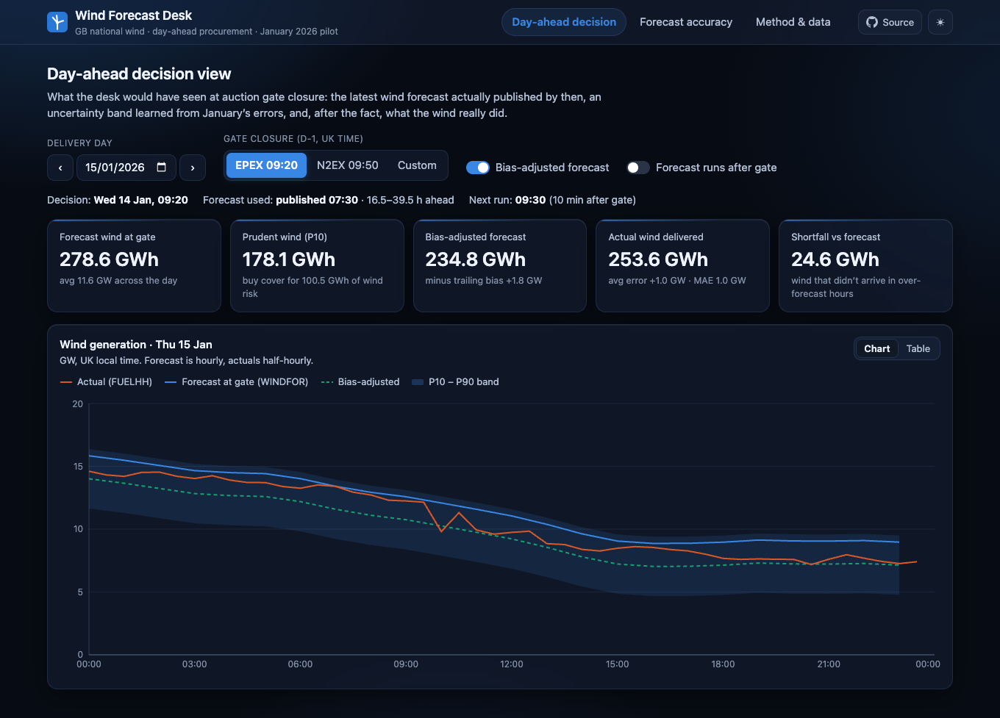
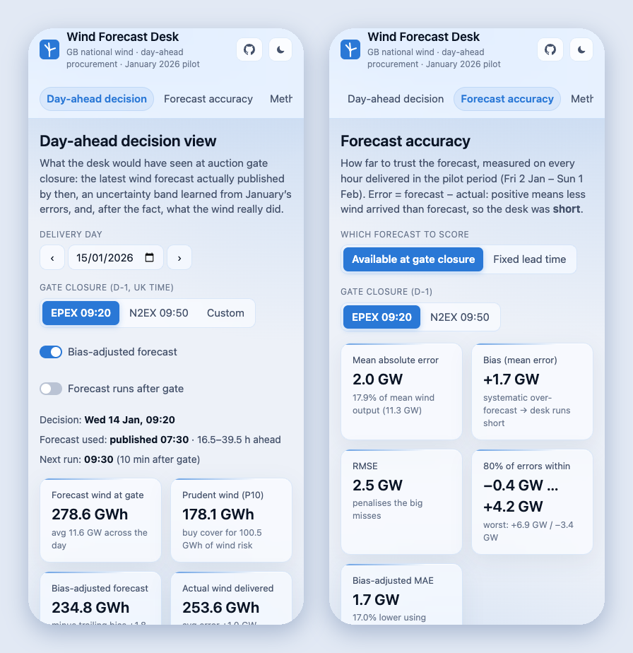
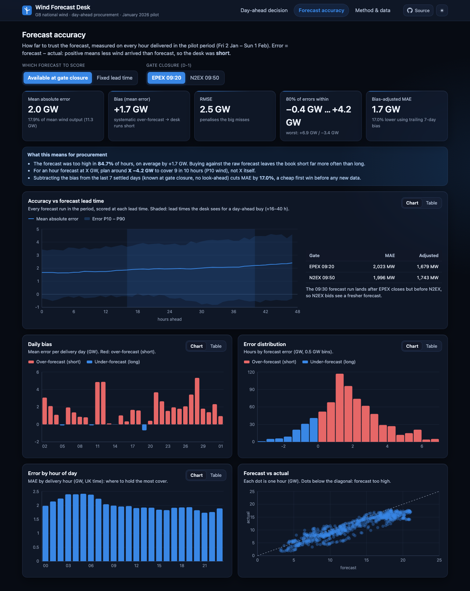
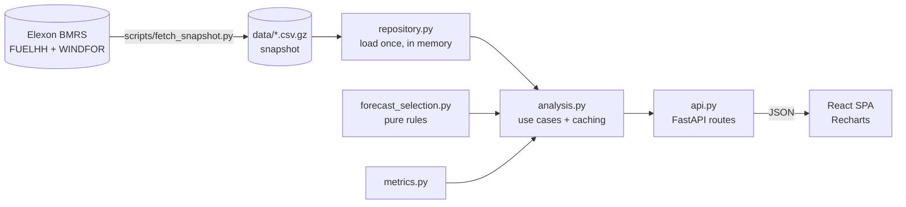

# Wind Forecast Desk

[](https://github.com/ice-009/data-bricks_swe/actions/workflows/ci.yml)
[](https://data-bricks-swe.vercel.app)
   

A web app for a UK energy utility's day-ahead power trading desk. It answers two questions for every purchase decision made in **January 2026**:

1. **What did the latest wind forecast say when we had to buy?** For each delivery day it shows the newest Elexon WINDFOR forecast published before the day-ahead auction gate closure (EPEX 09:20 / N2EX 09:50 on D-1), with an uncertainty band and the actual outturn.
2. **How far can we trust it?** Error metrics (MAE, RMSE, bias, P10/P90), how accuracy changes with lead time, by hour of day, by day, and a bias-adjusted forecast that is about 17% more accurate.

### 🔗 Live app: **https://data-bricks-swe.vercel.app**



**Contents:** [App tour](#app-tour) · [Quick start](#quick-start) · [Repository layout](#repository-layout) · [Architecture](#architecture) · [Domain & method](#domain-and-method) · [Key findings](#key-findings-january-2026) · [Engineering practices](#engineering-practices) · [Deployment](#deployment) · [Use of AI tools](#use-of-ai-tools)

---

## App tour

All screenshots are from the live deployment, using the real January 2026 Elexon data.

### 1. Day-ahead decision view

Pick a delivery day and a gate closure (EPEX 09:20, N2EX 09:50 or any custom time). The view shows exactly what the desk knew at that moment:

- **Context strip:** when the decision was made, which forecast run was used (here the 07:30 run, 16.5–39.5 h ahead) and when the next run arrived (09:30, 10 minutes *after* EPEX closed).
- **KPI tiles:** forecast energy for the day, a prudent P10 volume (how much wind risk to cover), the bias-adjusted forecast, the actual outturn and the shortfall.
- **Chart:** the forecast at the gate (blue) with its P10–P90 band, the bias-adjusted forecast (green, dashed) and the actual FUELHH outturn (orange).

Turning on **Forecast runs after gate** draws every run published after the decision in grey, which shows how far the forecast kept moving after the desk had committed. Hovering gives exact hourly values:



### 2. Forecast accuracy

Scores every delivered hour in the period, either *as available at gate closure* or at a *fixed lead time* (0–48 h).

- **KPI tiles:** MAE, bias, RMSE, the 80% error range, and the bias-adjusted MAE.
- **Procurement callout:** the same metrics translated into what they mean for buying.
- **Charts:**
  - accuracy vs lead time, with an EPEX vs N2EX comparison
  - daily bias
  - error distribution
  - error by hour of day
  - forecast vs actual scatter



### 3. Method & data

How every number is produced: data sources, the "available at the decision" rule, the metric definitions, how the uncertainty band and bias adjustment are built, and known limitations.



### Dark mode and mobile

The UI is a frosted-glass design in a single blue hue. It follows the system light or dark setting, and the ☾/☀︎ button in the header switches it manually. Every chart has a **Table** toggle for exact numbers, and the layout works down to phone width. The **Source** button in the header links to this repository.

| Dark mode | Phone (390 px) |
|---|---|
|  |  |

<details>
<summary>Accuracy view in dark mode</summary>



</details>

---

## Quick start

### Option A: Docker (one command)

```bash
docker compose up --build
# open http://localhost:8000
```

A single image builds the React app and serves it from the FastAPI process, so there is one origin and no CORS.

### Option B: local dev (hot reload)

Requires Python 3.12 and Node 22.

```bash
make install     # backend venv + npm ci
make dev-api     # FastAPI on :8000 (OpenAPI docs at /docs)
make dev-web     # Vite on :5173, proxies /api to :8000
make test        # pytest + vitest
make lint        # ruff + tsc
```

Without `make`:

```bash
cd backend && python3.12 -m venv .venv && .venv/bin/pip install -r requirements-dev.txt
.venv/bin/uvicorn app.main:app --reload --port 8000
cd frontend && npm ci && npm run dev
```

---

## Repository layout

```
.
├── backend/                     Python 3.12 · FastAPI · pandas
│   ├── app/
│   │   ├── main.py              App factory: middleware, routers, serves React build in prod
│   │   ├── api.py               HTTP layer: param parsing/validation, no business logic
│   │   ├── schemas.py           Pydantic response models (the API contract)
│   │   ├── analysis.py          Use cases: day-ahead view, accuracy, horizon curve, bias adjustment
│   │   ├── forecast_selection.py  Pure functions: "which forecast was available at time T?"
│   │   ├── metrics.py           Error metrics (MAE, RMSE, bias, nMAE, quantiles, histogram)
│   │   ├── repository.py        Loads the data snapshot (or fetches it live) into memory
│   │   ├── elexon.py            Elexon BMRS client (FUELHH + WINDFOR streams, chunked, retried)
│   │   └── config.py            Settings, data window, gate-closure presets
│   ├── data/                    Gzipped CSV snapshot of Jan 2026 actuals + forecasts (~110 KB)
│   ├── scripts/fetch_snapshot.py  Re-download the snapshot from Elexon
│   ├── tests/                   pytest: selection rules, metrics, use cases, API (synthetic data)
│   ├── requirements.txt / requirements-dev.txt
│   └── pyproject.toml           ruff + pytest config
├── frontend/                    React 18 · TypeScript · Vite · Recharts
│   └── src/
│       ├── App.tsx              Shell, tabs (hash-routed), theme toggle
│       ├── api.ts / types.ts    Typed API client mirroring backend/app/schemas.py
│       ├── views/               DayAheadView, AccuracyView, MethodView
│       ├── components/          KPI tiles, chart card with table view, legend, tooltip, controls
│       ├── hooks/useApi.ts      Fetch hook with abort + keep-previous-data
│       └── format.ts (+ test)   UK-time and GW/GWh formatting
├── api/index.py                 Vercel serverless entrypoint (re-exports the FastAPI app)
├── requirements.txt             Python deps for the Vercel function
├── Dockerfile                   Multi-stage: build React, run uvicorn (Heroku / any container host)
├── docker-compose.yml
├── heroku.yml                   Heroku container deploy
├── vercel.json                  Vercel: static React + Python function for /api/*
├── Makefile
├── .github/workflows/ci.yml     Lint, test, build, docker smoke test
└── docs/                        Screenshots (from the live app), video talk track
```

---

## Architecture



**Layers.** HTTP (`api.py`) → use cases (`analysis.py`) → pure domain functions (`forecast_selection.py`, `metrics.py`) → data access (`repository.py`, `elexon.py`). The domain functions take and return DataFrames and know nothing about HTTP, so they are unit-tested with tiny hand-built inputs.

**Why a snapshot?** January 2026 is historical and does not change. Shipping a 110 KB snapshot gives fast cold starts on serverless, no runtime dependency on Elexon's availability or rate limits, and reproducible numbers. If the snapshot is missing, the app fetches it live (`ALLOW_LIVE_FETCH=true`), so pointing it at a new month is a config change plus `make snapshot`.

**Caching.** The dataset is ~20k forecast rows, so everything runs in memory with pandas. Expensive per-gate computations are memoised on the `WindAnalytics` singleton, and the horizon curve is warmed at startup. Typical responses take a few milliseconds.

### API

| Endpoint | Purpose |
|---|---|
| `GET /api/meta` | Data window, gate presets, run times, row counts |
| `GET /api/day-ahead?delivery_date=2026-01-15&gate=09:20` | Forecast at gate (+P10/P90, bias-adjusted), actuals, later runs, energy totals, day error |
| `GET /api/accuracy?gate=epex` or `?horizon_h=24` | Summary metrics, by-day, by-hour, histogram, scatter |
| `GET /api/horizon-curve` | MAE and error P10/P90 vs lead time (0–48 h); EPEX vs N2EX comparison |
| `GET /api/health` | Liveness |

`gate` accepts a preset id (`epex`, `n2ex`) or any `HH:MM` (UK local time on D-1). Interactive docs: `/docs`.

---

## Domain and method

| Concept | Implementation |
|---|---|
| Decision window | Decisions on 1–31 Jan 2026 → delivery days 2 Jan – 1 Feb 2026 |
| Decision time | Day-ahead auction gate closure on D-1, UK local time: **EPEX 09:20**, **N2EX 09:50**, or custom. Time zones handled via `Europe/London`, so BST and clock-change days work. |
| Forecast "available" | Per delivery hour, the latest WINDFOR value with `publishTime ≤ gate closure`. Nothing published later is ever used (no look-ahead). |
| Error | `forecast − actual` (MW) at hourly `startTime`s present in both datasets. **Positive = over-forecast = desk is short.** |
| Metrics | MAE, RMSE, bias, nMAE (MAE / mean actual), error P10/P50/P90, extremes. MAPE avoided because wind can be near zero. |
| Uncertainty band | Empirical P10/P90 of gate-closure errors on the *other* days (leave-one-day-out), applied to the day's forecast |
| Bias-adjusted forecast | Forecast minus the mean error of the previous 7 *settled* days (D-8 … D-2, all known at gate closure on D-1) |

WINDFOR is published 8× a day (02:30, 04:30, 07:30, 09:30, 11:30, 15:30, 18:30, 22:30 UTC), hourly, about 66 h ahead. FUELHH is half-hourly.

### Key findings (January 2026)

- **Day-ahead MAE ≈ 2.0 GW** (17.9% of mean wind output of 11.3 GW) at the EPEX gate. RMSE 2.5 GW.
- **Strong systematic over-forecast: bias +1.7 GW.** The forecast was too high in ~85% of hours, so buying against it leaves the book short far more often than long.
- **80% of hourly errors fall between −0.4 GW and +4.2 GW.** A prudent plan for an hour forecast at X GW is about X − 4.2 GW of wind (P10).
- **Lead time matters less than bias.** MAE rises from about 1.7 GW at 0 h to about 2.25 GW at 42 h ahead, while the bias alone accounts for most of the error.
- **A 7-day trailing bias correction cuts MAE by ~17%** (2.02 → 1.68 GW), uses no look-ahead, and needs no new data.
- **Gate timing:** the 09:30 forecast run lands 10 min *after* EPEX closes but before N2EX, so N2EX bids see a slightly fresher forecast (MAE 1.996 vs 2.023 GW).
- Errors are largest overnight (03:00–06:00 UK) and smallest late evening.

Part of the persistent bias is likely a scope difference: FUELHH is metered output *after* curtailment and constraint actions, so it can sit below a forecast of available wind. Confirming this would need data beyond the brief's scope.

---

## Engineering practices

- **Tests:** 27 backend tests covering gate-time and BST conversion, clock-change days, cutoff inclusivity, per-target selection, the no-look-ahead guarantee of the bias adjustment, metric maths and API validation. All use deterministic synthetic data and never touch the network. Frontend: vitest for formatting and time-zone logic.
- **Static checks:** ruff (lint + format), TypeScript `strict`.
- **CI** (GitHub Actions): backend lint and tests, frontend typecheck, tests and build, then a Docker build and container smoke test.
- **Typed contract:** Pydantic response models (OpenAPI at `/docs`) mirrored by `frontend/src/types.ts`.
- **Accessibility and UX:** every chart has a table view; colour-blind-validated series palette; frosted-glass light and dark themes built from CSS custom properties (one accent hue); responsive down to phone width; times always shown in UK local time.
- **Config over code:** decision window, gate presets and bias window live in `config.py`, with env overrides (`SNAPSHOT_DIR`, `ALLOW_LIVE_FETCH`, `CORS_ORIGINS`, `STATIC_DIR`).

---

## Deployment

**Vercel** (static React plus a Python serverless function):

Live at **https://data-bricks-swe.vercel.app**. The Vercel project is connected to this GitHub repo, so every push to `main` deploys to production automatically, and GitHub shows the Vercel deploy status on each commit.

```bash
npx vercel --prod    # uses vercel.json: builds frontend/, deploys api/index.py for /api/*
```

`vercel.json` pins `"framework": "vite"`. Without it, Vercel detects the root `requirements.txt` as a pure Python app and routes every path to the function. The root `requirements.txt` lists the backend dependencies inline because Vercel's parser does not follow `-r` includes.

**Heroku** (container):

```bash
heroku create <app-name> --stack container
git push heroku main   # builds the Dockerfile via heroku.yml; $PORT is honoured
```

---

## Possible next steps

- Add demand and solar forecasts to show the *net* volume to procure, not just wind.
- Level-dependent and seasonal uncertainty bands (quantile regression on forecast level and hour).
- Price-aware view: cost of being short vs long, using imbalance prices.
- Scheduled ingestion (cron) into Postgres for live operation beyond the pilot month.

---

## Use of AI tools

This project was built with **[Claude Code](https://claude.com/claude-code)** (Anthropic's AI coding assistant), as the brief permits. It was used to:

- scaffold the backend and frontend, and write most of the code and tests
- explore the Elexon datasets and check the day-ahead auction gate-closure times
- draft this README and the video talk track

I reviewed every design decision, checked the numbers in this README against the real data and the running app, and verified lint, tests, the Docker image and CI myself.
